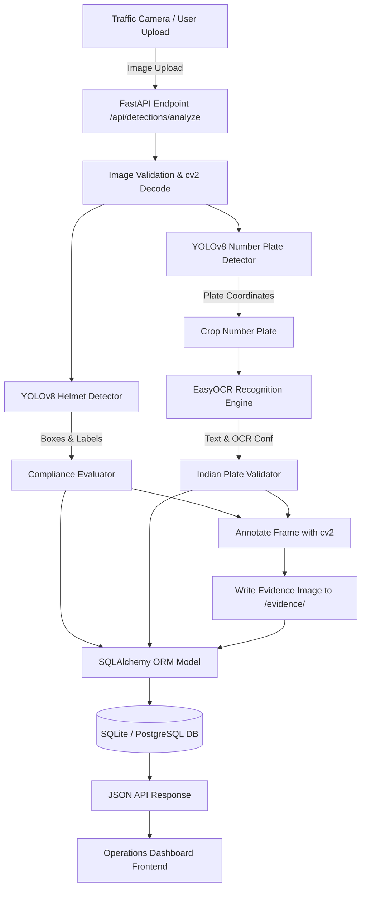

# Autonomous Helmet Detection & Traffic Compliance Monitoring System for Smart City

An end-to-end intelligent traffic monitoring platform designed for Indian urban roadways. The system automatically inspects traffic frames for motorcycle helmet compliance, localizes vehicle number plates using YOLOv8, extracts alphanumeric registration strings using EasyOCR, annotates evidence images, persists audit logs into a database, and presents real-time analytics on an interactive operations dashboard.

---

## 1. Project Overview

In urban environments across India, helmet non-compliance among two-wheeler riders remains a major cause of fatal traffic accidents. Manually identifying violators and noting registration plates from CCTV feeds is labor-intensive and prone to omission.

This project delivers an integrated computer vision and web monitoring application:
1. **Helmet Compliance Detection**: Evaluates whether riders are wearing helmets using genuine deep learning models.
2. **Indian Number Plate Localization**: Detects license plates on motorcycles, cars, auto-rickshaws, and commercial vehicles using a specialized YOLOv8 detector.
3. **Optical Character Recognition (OCR)**: Extracts registration strings from detected plate crops using EasyOCR with regex normalization for Indian vehicle numbering standards (e.g. `GJ01NC2394`, `KL785559`).
4. **Operations Dashboard**: An operations UI with live KPI stats, violation review workflows (approve/reject), evidence inspection modals, and an interactive Frame Analysis Studio.
5. **Database Audit & Persistence**: Stores structured records with detector confidence, OCR confidence, timestamps, review states, and evidence image paths.

---

## 2. Key Features

- **Dual AI Engine**:
  - **Helmet Detection**: Deep learning model detecting riders `With Helmet` and `Without Helmet` with real bounding boxes and confidence scores.
  - **Number Plate Detector (YOLOv8n)**: High-recall detector (`license_plate_yolov8n.pt`) identifying standard and non-standard Indian vehicle plates.
  - **Text Recognition (EasyOCR)**: Multi-stage OCR with contrast normalization and Indian registration plate pattern validation.
- **Fail-Safe Independent Workflows**:
  - If a helmet violation occurs without a readable plate, the violation is logged and marked `unreadable`.
  - If a vehicle has a visible plate without riders (e.g. cars), the plate is detected and recognized independently.
- **Transparent Classification**:
  - Unreadable or blurred plates are never fabricated; raw OCR text and validation status are distinctly reported.
- **Interactive Web Interface**:
  - Drag-and-drop frame upload.
  - Real-time side-by-side visualization of raw image, bounding boxes, plate crops, and OCR confidence.
  - Audit log table with filter controls (search by plate, compliance filter, review status filter).
  - Human-in-the-loop violation approval/rejection.
- **RESTful API**:
  - Full OpenAPI/Swagger documentation at `/docs`.
  - Health check endpoints (`/api/health`, `/api/health/database`).
  - Analysis endpoint (`/api/detections/analyze`) and plate-specific recognition (`/api/number-plates/recognize`).

---

## 3. Technology Stack

- **Computer Vision & AI**: PyTorch, Ultralytics YOLOv8, EasyOCR, OpenCV (`cv2`), NumPy
- **Backend API**: FastAPI, Uvicorn, Pydantic v2
- **Database**: SQLAlchemy 2.0 ORM, SQLite (local zero-config) / PostgreSQL (production)
- **Frontend**: Vanilla JavaScript (ES6+), Modern CSS3 (responsive grid, glassmorphism, dark palette)
- **Testing**: PyTest, FastAPI TestClient, Playwright Browser Automation

---

## 4. Architecture & Data Flow



---

## 5. Folder Structure

```text
├── backend/
│   ├── app/
│   │   ├── database.py             # SQLAlchemy engine & session setup
│   │   ├── init_db.py              # Database table creation script
│   │   ├── main.py                 # FastAPI application, routers & dashboard mounting
│   │   ├── models.py               # SQLAlchemy ORM Violation model
│   │   ├── test_db.py              # Database insert/retrieval verification script
│   │   └── services/
│   │       └── pipeline_service.py # Integrated helmet + plate + OCR pipeline
│   ├── evidence/                   # Generated annotated evidence images
│   ├── tests/                      # API & pipeline automated test suite
│   ├── requirements.txt            # Backend Python dependencies
│   └── .env.example                # Database & server configuration template
├── frontend/
│   ├── index.html                  # Operations dashboard HTML
│   ├── styles.css                  # Modern UI styles & theme
│   └── app.js                      # Dynamic frontend logic & API client
├── helmet/
│   ├── detector.py                 # Helmet detection inference module
│   └── weights/
│       └── helmet_yolov8n.pt       # Pretrained YOLOv8 helmet model weights
├── number_plate/
│   ├── detector.py                 # YOLOv8 license plate detector
│   ├── ocr.py                      # EasyOCR text reader & Indian plate validator
│   ├── pipeline.py                 # Combined detection + OCR processing
│   ├── weights/
│   │   └── license_plate_yolov8n.pt# YOLOv8 license plate weights
│   ├── test_images/                # 12 genuine Indian vehicle test images
│   │   └── ground_truth.csv        # Ground truth annotations
│   ├── results/                    # Benchmark evaluations and reports
│   └── tests/                      # Number plate unit tests
├── training/
│   ├── helmet_dataset.py           # 16-class Faster R-CNN dataset loader
│   ├── model.py                    # 16-class Faster R-CNN architecture definition
│   └── train.py                    # 20-epoch training script
├── checkpoints/
│   └── SHA256SUMS.txt              # Checkpoint cryptographic hashes
├── logs/
│   └── training_history.csv        # 20-epoch Faster R-CNN training log
├── README.md                       # Main project documentation
├── RUNNING_GUIDE.md                # PowerShell step-by-step startup guide
├── DEMO_REPORT.md                  # Comprehensive demonstration & benchmark report
└── TEST_REPORT.md                  # Automated test suite results
```

---

## 6. Model Information

1. **Helmet Detection**:
   - Model: YOLOv8n Helmet Detection (`helmet/weights/helmet_yolov8n.pt`, 6.2 MB)
   - Classes: `With Helmet`, `Without Helmet`
   - Inference Device: CPU
   - Architectural Note: Faster R-CNN 16-class model architecture is defined in `training/model.py` with 20 epochs of external training recorded in `logs/training_history.csv` and hashes in `checkpoints/SHA256SUMS.txt`. The live operational system uses the lightweight, high-speed YOLOv8 model for real-time CPU execution.

2. **Number Plate Localization**:
   - Model: YOLOv8n License Plate (`number_plate/weights/license_plate_yolov8n.pt`, 6.2 MB)
   - Class: `license_plate`
   - Confidence Threshold: 0.15 - 0.25

3. **Number Plate Recognition**:
   - Engine: EasyOCR (`english`)
   - Preprocessing: Grayscale conversion, adaptive contrast enhancement, bilateral filtering
   - Postprocessing: Alphanumeric sanitization, Indian registration format matching (Regex: `^[A-Z]{2}[0-9]{1,2}[A-Z]{0,3}[0-9]{4}$`)

---

## 7. Quick Start

### Prerequisites
- Python 3.10+ (Windows / Linux / macOS)
- Git

### 1. Activate Environment & Install Dependencies
```powershell
.\venv\Scripts\Activate.ps1
pip install -r backend/requirements.txt
```

### 2. Start Backend Server
```powershell
cd backend
..\venv\Scripts\python -m uvicorn app.main:app --host 127.0.0.1 --port 8000
```

### 3. Open Application Dashboard
Navigate to:
```text
http://127.0.0.1:8000/dashboard/
```

### 4. Interactive API Documentation
Navigate to:
```text
http://127.0.0.1:8000/docs
```

---

## 8. Known Limitations

- **Extreme Weather / Night Conditions**: Heavy glare or motion blur can reduce OCR character recognition accuracy.
- **Custom / Fancy Fonts**: Non-standard stylized or regional script plates may fail Indian standard regex validation and will be tagged `unreadable`.
- **CPU Inference Latency**: EasyOCR inference takes ~0.5s - 1.5s per plate crop on CPU. GPU acceleration is supported when CUDA is available.
